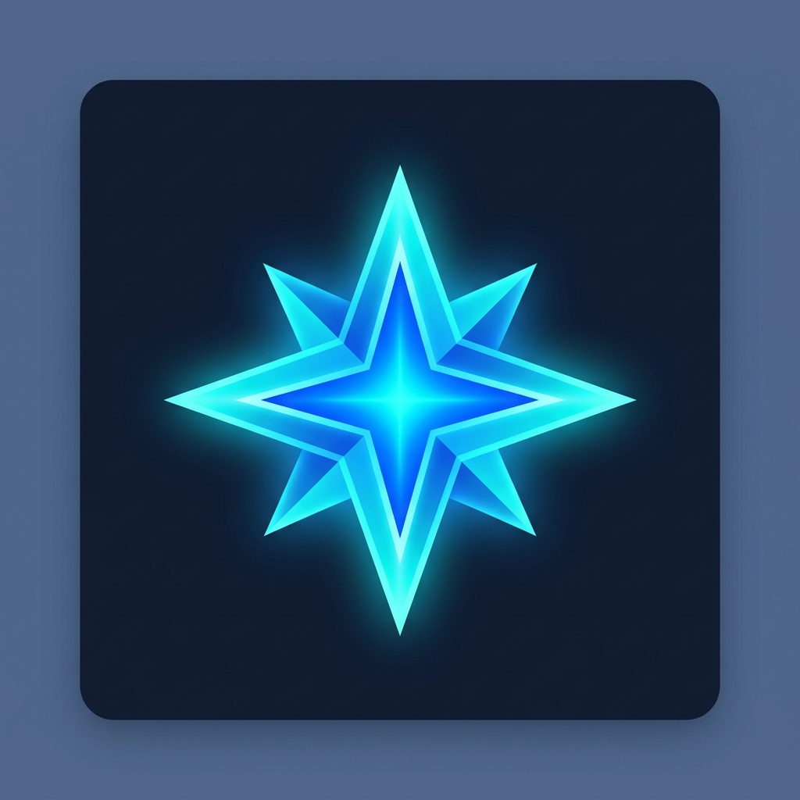

# 🤖 Google AI Studio per Android (v2.0 - Hybrid & Multimodal)

<p align="center">
  
</p>

<p align="center">
  <b>Il client nativo e ibrido avanzato per Google AI Studio: Deep JS Injection, Chat Multimodale Nativa (Immagini, PDF, Audio) e Sincronizzazione della Cronologia.</b>
</p>

<p align="center">
  
  
  
  
  
  
  
</p>

---

## 📲 Download & Installazione Rapida

Scarica l'ultimo file **`.apk`** pronto per l'installazione sul tuo smartphone Android:

### 👉 [**Scarica l'ultima versione (.APK) dalle Releases**](../../releases/latest)

> 💡 **Come installarlo sul telefono:**
> 1. Scarica il file `AI_Studio.apk`.
> 2. Aprilo dall'app File o dalle notifiche di download.
> 3. Se richiesto, attiva l'opzione *"Consenti l'installazione da questa fonte"*.
> 4. Conferma l'installazione e apri l'app!

---

## 🌟 Nuove Funzionalità Avanzate (v2.0)

### 1. 💉 Integrazione Profonda: Iniezione JavaScript nel Web Studio (`evaluateJavascript`)
- Dalla scheda **Prompts**, puoi toccare **"Inject Web"** su qualsiasi prompt o template salvato.
- L'app attiva la scheda Web Studio e **inietta istantaneamente il testo e le istruzioni nei campi di input di Google AI Studio** simulando gli eventi del DOM (`input`, `change`), compilando la textarea del sito web senza dover fare copia-incolla manuale.

### 2. 🔄 Sincronizzazione Web-to-Native della Cronologia
- Pulsante dedicato **"Sync Web"** nel Prompt Hub.
- Esegue uno script non intrusivo nella WebView che estrae i titoli e gli argomenti delle sessioni recenti di Google AI Studio, memorizzandoli nel database locale per renderli consultabili offline nell'interfaccia nativa Compose.

### 3. 🖼️ Supporto Multimodale Avanzato nella Native Chat (Immagini, PDF, Audio)
- La Native Chat supporta ora l'invio e l'analisi di:
  - 📷 **Immagini** (JPEG, PNG, WEBP)
  - 📄 **Documenti PDF**
  - 🎙️ **File Audio** (MP3, WAV, AAC)
- La trasmissione sfrutta i payload `inline_data` base64 delle API REST di Gemini (`gemini-2.5-flash` e `gemini-1.5-pro`), garantendo risposte ultra-veloci con il **90% di RAM e consumo di batteria in meno** rispetto al browser web.

### 4. 🔋 Ibernazione Energetica & AMOLED Pure Black
- **Ibernazione della WebView**: Non appena si passa alla Native Chat o ai Prompts, o quando l'app è in background, i loop JavaScript della WebView vengono sospesi (`pauseTimers()`), eliminando il consumo nascosto di batteria.
- **Tema AMOLED Pure Black (`#000000`)**: Spegne fisicamente i pixel sui display OLED/AMOLED.
- **Dynamic Color (Material You)**: Si adatta alla palette del tuo smartphone (Android 12+).

---

## 🛠️ Requisiti di Sistema

- **Sistema Operativo**: Android 7.0 (Nougat, API 24) o superiore.
- **RAM Minima**: 2 GB (consigliati 3 GB+).
- **Connessione**: Internet (Wi-Fi o Dati mobili).

---

## 💻 Come Compilare il Codice da Sorgente

1. Clona il repository:
   ```bash
   git clone https://github.com/tuo-username/Google-AI-Studio-for-Android.git
   ```
2. Apri il progetto con **Android Studio** (versione Ladybug o successiva).
3. Attendi il completamento della sincronizzazione di Gradle.
4. Genera l'APK Debug:
   ```bash
   gradle :app:assembleDebug
   ```
   Troverai il file compilato in: `app/build/outputs/apk/debug/app-debug.apk`.

---

## ⚖️ Disclaimer

Questo progetto è un'applicazione client open-source indipendente e **non è ufficialmente affiliata, sponsorizzata né approvata da Google LLC**. Tutti i marchi registrati, loghi e nomi appartengono ai rispettivi proprietari.

---

## 📄 Licenza

Rilasciato sotto licenza [MIT](LICENSE).
